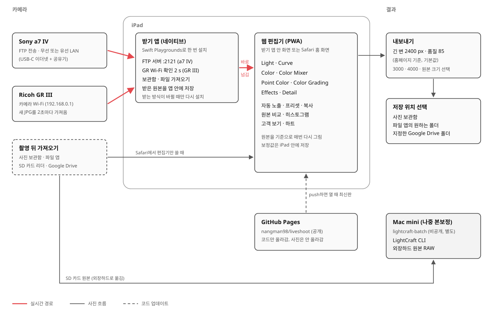

# LiveShoot: iPad 실시간 받기·보정

**a7 IV(FTP), GR III(Wi-Fi), 사진 보관함으로 들어온 JPG를 받는 즉시 원본 기준으로 보정해 띄우고 그 자리에서 슬라이더로 고쳐 홈페이지 크기(긴 변 2400 px, 품질 85)로 내보내는 iPad 앱(0.3, Swift Playgrounds 프로젝트).** 0.3에서 이미 있는 사진을 보관함·파일 앱(Google Drive 포함)에서 골라 가져오는 기능을 넣음. 2026-10-23 GitHub Actions에서 iOS 빌드가 성공함(Xcode 16.4, iOS SDK 18.5, `** BUILD SUCCEEDED **`). 받기와 보정 계산은 Mac에서 실측함(아래 시험 결과). iPad 실기기와 실제 카메라로는 아직 돌려 보지 않음.

## 구성

- **지금 (0.3)**: 받기와 보정이 앱 하나에 들어 있음. 보정은 노출, 대비, 하이라이트, 섀도, 색온도, 색조, Vibrance, 채도 8개
- **다음**: 보정 화면을 웹 편집기(GitHub Pages)로 옮기고 Curve, Color Mixer, Point Color, Color Grading, Effects, Detail을 넣음. 받기 앱은 받은 사진을 편집기로 넘기는 일만 해서 다시 설치할 일이 거의 없음
- **Mac mini와의 관계**: 원본 RAW 본보정은 별도 저장소 `lightcraft-batch`(비공개, LightCraft CLI)가 맡음. LiveShoot의 보정값은 Mac mini로 넘어가지 않음

## 파일

| 파일 | 내용 |
|---|---|
| `LiveShoot.swiftpm/Views.swift` | 화면: 큰 사진, 필름 띠, 받기·보정·내보내기 패널, 고객 보기 |
| `LiveShoot.swiftpm/Session.swift` | 사진 목록, 받기 켜고 끄기, 미리보기 캐시, 내보내기, 저장·복원 |
| `LiveShoot.swiftpm/Renderer.swift` | 자동 노출과 보정 8가지 (Core Image), JPEG 내보내기 |
| `LiveShoot.swiftpm/FTPServer.swift` | a7 IV FTP 전송을 받는 FTP 서버 (수동 모드) |
| `LiveShoot.swiftpm/GRClient.swift` | GR III Wi-Fi에서 새 JPG를 2초마다 가져옴 |
| `.github/workflows/ios-check.yml` | push마다 iOS SDK 문법 검사와 앱 빌드 |

## 받기

| 입력 | 카메라와 iPad 설정 | 앱 |
|---|---|---|
| a7 IV | 카메라 FTP 전송: 서버 = 앱에 뜬 iPad 주소, 포트 2121, 사용자·비밀번호 `liveshoot`, 수동(PASV) 모드 켬, 보안 프로토콜 끔, 자동 전송 켬, 전송 파일 JPEG. 카메라와 iPad를 같은 Wi-Fi(휴대폰 핫스팟 등)에 연결 | "a7 IV (FTP)" 켬 |
| GR III | 카메라 무선 LAN을 켜고 iPad 설정 → Wi-Fi에서 GR 네트워크에 접속 | "GR III (Wi-Fi)" 켬. 켠 뒤 찍은 JPG만 받음 |
| 그 밖 (새 사진) | Creators' App, GR WORLD, AirDrop, 케이블 가져오기로 사진 보관함에 들어온 사진 | "사진 보관함 (새 사진)" 켬 |
| 이미 있는 사진 | iPad 보관함, 파일 앱(Google Drive, SD 카드 리더 포함) | "보관함에서" 또는 "파일에서"로 여러 장 고름 |

- **GR III 방식**: 리코가 공개한 API가 아니라 GRsync가 쓰는 `GET http://192.168.0.1/v1/photos` 목록과 `/v1/photos/<폴더>/<파일>` 받기를 씀([GRsync](https://github.com/metalunk/GRsync)). 펌웨어가 바뀌면 안 될 수 있음
- **두 카메라 동시**: iPad가 GR Wi-Fi에 붙으면 a7 IV와 같은 Wi-Fi가 아니게 되어 a7 IV FTP는 끊김. a7 IV를 GR Wi-Fi에 붙이면 둘 다 될 수도 있지만 시험 전임 [잠정]
- **카메라 메뉴 이름**: 위 a7 IV 설정 이름은 Sony 기능 설명([Sony](https://www.sony.ca/en/interchangeable-lens-cameras/products/ilce-7m4/feature5)) 기준이고 실제 메뉴 문구는 펌웨어마다 다를 수 있음

## 보정

- **원본 기준**: 슬라이더를 움직일 때마다 원본(화면용은 긴 변 2560 px)에 처음부터 다시 입힘. "누르고 있으면 원본"으로 보정 전을 봄
- **자동 노출**: 사진마다 64 px로 줄인 그림의 log 평균 휘도를 중간 회색(선형 0.18)에 맞추는 EV를 출발점으로 넣음(±2.5 EV). 끄거나 노출 슬라이더로 더하고 뺄 수 있음
- **슬라이더 8개**: 노출 ±3 EV, 대비·하이라이트·섀도·색온도·색조·Vibrance·채도 ±100. 슬라이더를 두 번 누르면 0
- **새 사진의 출발점**: "기본으로 저장"한 값이 새 사진에 들어감. "새 사진에 이 보정 이어 쓰기"를 켜면 지금 보던 사진의 값을 이어 씀
- **하트**: 사진을 두 번 누르거나 하트를 누름. 사진 보관함에서 온 사진은 보관함 즐겨찾기도 같이 바뀜

## 내보내기

- **기본**: 긴 변 2400 px, JPEG 품질 85. `memory-photos/scripts/optimize-photos.mjs`의 `MAX_EDGE = 2400`, quality 85와 같음
- **선택**: 3000, 4000, 원본 크기, 품질 60–100
- **저장 위치**: 사진 보관함의 "LiveShoot" 앨범. 원본은 그대로임
- **유지**: 받은 원본과 보정값은 앱을 껐다 켜도 남음. "받은 사진 목록 비우기"로 지움

## iPad에 설치

1. App Store에서 Swift Playgrounds를 설치함
2. 파일 앱 → Google Drive → `project/AI도구_사용법/아이패드_라이브뷰어/LiveShoot.swiftpm.zip`을 눌러 풂
3. 풀린 `LiveShoot.swiftpm`을 Swift Playgrounds에서 열고 ▶를 누름. 사진 보관함과 로컬 네트워크 접근을 허용함
4. 빌드 오류나 이상한 동작은 화면을 캡처해 Claude에게 보여 줌

## 시험 결과

Mac(M4)에서 앱의 `Renderer`·`FTPServer`·`GRClient` 코드를 그대로 컴파일해 돌림(2026-10-23).

| 시험 | 결과 |
|---|---|
| FTP 받기 | Python `ftplib` 수동 모드로 JPG 2장 올림 → 둘 다 `226 Transfer complete`, 원본과 바이트 단위로 같음 |
| GR 받기 | GR처럼 응답하는 가짜 서버 → 연결 때 있던 1장은 건너뛰고 3초 뒤 새로 생긴 1장만 받음, 바이트 단위로 같음 |
| 자동 노출 | 노출 −1.5로 어둡게 만든 사진 +1.34 EV(밝기 87.7 → 136.0), +1.2로 밝게 만든 사진 −0.68 EV(170.2 → 137.5) |
| 슬라이더 1번 반영 | 2400 × 1600에서 5–19 ms |
| 색 방향 | 색온도 +50 → R−B 20.6 → 51.3 (따뜻함), 색조 +50 → G 155.4 → 147.6 (자주) |
| 내보내기 | 2400 × 1600, 품질 85, 370 KB |

밝기는 sRGB Rec. 601 luma 평균(0–255).

## Still open

- **야경**: 자동 노출이 야경을 너무 밝게 잡음(+1.62 EV, 밝기 106.6 → 178.8). 화면에서 노출을 내리거나 자동 노출을 끔
- **iPad 실기기**: Swift Playgrounds 빌드, 권한 창, FTP 받기(a7 IV 실기), GR III 실기 응답 형식은 아직 확인 못 함
- **RAW**: DNG·ARW·CR3 등은 iPadOS가 읽을 수 있으면 띄움. 실기기에서 확인 전임 [잠정]. 실시간은 JPEG 전송을 씀
- **FTP 계정**: 기본 계정 `liveshoot`/`liveshoot`은 코드에 공개됨. 같은 Wi-Fi의 다른 사람도 이 계정으로 올릴 수 있음. 다음 판에서 비밀번호를 바꿀 수 있게 함
