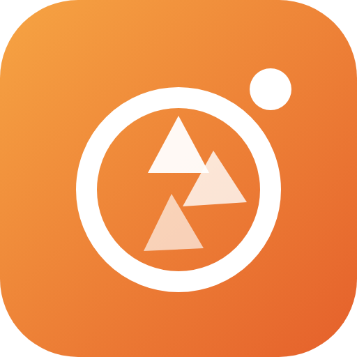
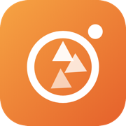
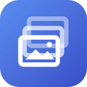

  

<h1 align="center">LiveShoot</h1>

<h3 align="center">찍는 즉시 iPad에서 보정해 보여 주는 촬영 현장 도구</h3>

  <b>사진을 원본 기준으로 실시간 보정하는 웹 편집기와, Sony a7 IV(FTP)·Ricoh GR III(Wi-Fi)에서 사진을 받는 iPad 앱.</b> 
  설치 없이 Safari에서 열어 홈 화면에 추가하면 앱처럼 씀. 고칠 때마다 다시 받을 필요가 없음.

  
  
  
  
  

  <a href="#기능">기능</a> ·
  <a href="#설치">설치</a> ·
  <a href="#카메라-연결">카메라 연결</a> ·
  <a href="#내보내기">내보내기</a> ·
  <a href="#구성">구성</a> ·
  <a href="#시험-결과">시험 결과</a> ·
  <a href="#같이-쓰는-앱">같이 쓰는 앱</a>

## 기능

**슬라이더를 움직이면 원본(화면용 긴 변 2048 px)에 처음부터 다시 입혀 바로 보여 줌.** 계산은 iPad GPU(WebGL2)에서 하고 사진은 iPad 밖으로 나가지 않음.

| 패널 | 들어 있는 것 |
|---|---|
| 프로필 | Basic(Color·Neutral·Vivid·Landscape·Portrait·Monochrome), Film 4, Cinematic 4, Snap 4(밝은 웨딩·벚꽃·깨끗한 피부·무디), B&W 4. 강도 0–200 %, 지금 사진으로 그린 썸네일. 슬라이더는 그대로 두고 그 아래에 깔림 |
| Auto·흑백 | Auto는 히스토그램 통계로 노출·대비·하이라이트·섀도·Whites·Blacks·Vibrance·채도를 정함(학습 모델 아님). B&W 버튼과 B&W Mix 8색 |
| RAW | ARW·CR3·RAF·DNG·NEF 등을 LibRaw(WebAssembly)로 해독. 화면은 1/2 크기로 빠르게, 원본 크기 내보내기는 전체 해독. 날짜·카메라·렌즈·ISO·셔터·조리개·초점거리·GPS를 읽어 내보낸 JPEG에 EXIF로 씀 |
| 자르기·회전 | 90° 회전, 좌우 뒤집기, 수평 맞추기 ±45°(빈 모서리 없이 자동 확대), 비율(원본·자유·1:1·4:5·3:2·16:9 등)과 끌어서 자르기 |
| Light | 노출 ±5 EV, 대비, 하이라이트, 섀도, Whites, Blacks, 자동 노출 |
| Curve | 점 커브 RGB·R·G·B, 구간 커브(Highlights·Lights·Darks·Shadows), Refine Saturation |
| Color | 화이트밸런스 스포이트, 색온도, 색조, Vibrance(피부색 보호), 채도 |
| Color Mixer | 8색(빨강·주황·노랑·초록·아쿠아·파랑·보라·마젠타) Hue·Saturation·Luminance |
| Point Color | 스포이트로 고른 색만 Hue·Saturation·Luminance, 범위 |
| Color Grading | 섀도·미드톤·하이라이트·전체 Hue·Saturation·Luminance, Blending, Balance |
| Effects | Texture, Clarity, Dehaze, Vignette(Midpoint·Feather·Roundness·Highlights), Grain(Size·Roughness) |
| Detail | Sharpening(Radius·Detail·Masking), Noise Reduction(Detail·Contrast), Color Noise Reduction(Detail·Smoothness) |
| 기본 | 히스토그램, 되돌리기 ↶·다시 하기 ↷(⌘Z·⇧⌘Z, 사진마다), 보정 복사·붙여넣기, 프리셋, 새 사진 기본 보정, 새 사진에 이어 쓰기 |
| 보기 | 누르고 있으면 원본, 하트(두 번 누르기), 좌우로 넘기기, 고객 보기(사진만) |

- **초기화**: 슬라이더를 두 번 누르면 그 값만, 패널 제목의 "초기화"는 그 패널 전체
- **자동 노출**: 128 px로 줄인 그림의 log 평균 휘도를 중간 회색(선형 0.18)에 맞추는 EV(±2.5)를 출발점으로 넣음. 올릴 때는 가장 밝은 1 % 화소가 날아가기 직전까지만 올림
- **복사·프리셋**: 자르기·회전은 옮기지 않음(사진마다 다르므로)
- **보관**: 가져온 원본과 보정값은 iPad 브라우저(IndexedDB)에 남아 다시 열어도 그대로임

## 설치

| 무엇 | 어떻게 | 업데이트 |
|---|---|---|
| **웹 편집기** | iPad Safari로 [nangman98.github.io/liveshoot](https://nangman98.github.io/liveshoot/) 열기 → 공유 버튼 → **홈 화면에 추가** | 자동. 앱을 한두 번 껐다 켜면 새 판으로 바뀜 |
| **받기 앱** (카메라 실시간) | Swift Playgrounds로 `LiveShoot.swiftpm` 열고 ▶. 자세히는 [받기 앱 README](LiveShoot.swiftpm/README.md) | 받는 방식이 바뀔 때만 다시 설치 |

웹 편집기만으로도 "사진 가져오기"를 눌러 보관함·파일 앱(Google Drive, SD 카드 리더 포함)의 사진을 여러 장 골라 보정할 수 있음.

## 카메라 연결

| 카메라 | 무선 | 유선 |
|---|---|---|
| Sony a7 IV | 카메라 FTP 전송 → 받기 앱의 FTP 서버(포트 2121, 수동 모드). 카메라와 iPad를 같은 Wi-Fi(휴대폰 핫스팟·여행용 공유기)에 연결 | USB-C 이더넷 어댑터로 같은 공유기에 연결하면 같은 FTP로 받음([Sony](https://www.sony.ca/en/interchangeable-lens-cameras/products/ilce-7m4/feature5)). 케이블 한 줄 연결 촬영은 iPadOS 지원이 불확실함 |
| Ricoh GR III | iPad를 GR Wi-Fi에 연결하면 받기 앱이 2초마다 새 JPG를 가져옴(비공식 `GET /v1/photos`, [GRsync](https://github.com/metalunk/GRsync) 방식) | 연결 촬영 기능 없음. 촬영 뒤 카드·케이블로 가져오기 |

## 내보내기

**원본에서 다시 그려 JPEG로 만듦. 기본은 홈페이지와 같은 긴 변 2400 px, 품질 85. 원본 JPEG의 촬영 날짜·카메라·위치(EXIF)를 그대로 넣음.** 3000, 4000, 원본 크기(iPad Safari 한도 약 16 MP 안쪽)도 고를 수 있음.

| 보낼 곳 | 내용 |
|---|---|
| 공유 시트 | 사진 보관함 저장, 파일 앱의 원하는 폴더(Google Drive 폴더 포함), AirDrop |
| 다운로드 | 파일 앱의 다운로드 폴더 |
| Google Drive 지정 폴더 | 한 번 고른 Drive 폴더로 바로 올림. 아래 설정이 한 번 필요함 |

### Google Drive 직접 올리기 설정

1. [Google Cloud 콘솔](https://console.cloud.google.com/)에서 새 프로젝트를 만듦
2. "API 및 서비스 → 라이브러리"에서 **Google Drive API**와 **Google Picker API**를 사용 설정함
3. "OAuth 동의 화면"을 외부로 만들고 테스트 사용자에 본인 Gmail을 넣음
4. "사용자 인증 정보 → OAuth 클라이언트 ID"를 웹 애플리케이션으로 만들고 승인된 JavaScript 원본에 `https://nangman98.github.io`를 넣음
5. "사용자 인증 정보 → API 키"를 만들고 HTTP 리퍼러를 `https://nangman98.github.io/*`로 제한함
6. 대시보드의 **프로젝트 번호**를 확인함
7. 편집기 "내보내기 → 보낼 곳: Google Drive 지정 폴더"에 클라이언트 ID, API 키, 프로젝트 번호를 넣고 "Drive 폴더 고르기"를 누름

- **위치 정보**: "위치 정보(GPS) 함께 저장"을 끄면 날짜·카메라는 두고 위치만 뺌. 방향(Orientation)은 사진에 입힌 뒤 1로 적음
- **HEIC 원본**: 지금은 EXIF를 JPEG 원본에서만 옮김

권한은 `drive.file`만 씀. 고른 폴더와 앱이 올린 파일에만 접근함.

## 구성

- **웹 편집기** (`docs/`): GitHub Pages로 배포. `docs/sw.js`의 `VERSION`(= `docs/js/main.js`의 `VERSION`)을 올려 push하면 기기에 새 판이 들어감
- **받기 앱** (`LiveShoot.swiftpm/`): a7 IV FTP, GR III Wi-Fi, 사진 보관함에서 받음. 지금(0.3)은 자체 보정 8개를 가진 따로 된 앱임. 받은 사진을 웹 편집기로 넘기는 연결은 다음 판에서 넣음
- **Mac mini 본보정**: 원본 RAW는 별도 저장소 `lightcraft-batch`(비공개, LightCraft CLI)가 맡음. LiveShoot 보정값은 넘어가지 않음

## 시험 결과

2026-10-23 Mac의 Chrome(헤드리스, 1366 × 1024)에서 웹 편집기를 자동으로 조작해 잼. iPad Safari 실기기 시험은 아직 안 함.

| 시험 | 결과 |
|---|---|
| 프로필·Auto·흑백·구간 커브 11가지 | 11/11 통과. 썸네일 22개, 컬러 Basic 프로필에서 회색 패치 채도차 0.0, 인물 계열 피부 색상각 변화 최대 1.6°, 흑백 프로필 채도 0, Auto로 어두운 사진 평균 80 → 124, B&W Mix 파랑 −80이 파랑 패치만 71 → 37 |
| RAW (Sony FX30 ARW, 6240 × 4168) | 가져오기 0.5 s, 2400 px 내보내기 0.5 s(Mac Chrome). 날아간 화소 0.67 %. 내보낸 JPEG를 Pillow로 읽으니 Sony·ILME-FX30·2023:04:28 15:01:20·ISO 800·1/125 s·F5·29 mm·E 18-135mm F3.5-5.6 OSS가 맞음 |
| 자르기·회전·EXIF·되돌리기 16가지 | 16/16 통과. 90° 회전 2048×1365 → 1365×2048, 수평 7° 네 모서리 빈칸 없음, 1:1 자르기 내보내기 1249×1249, 날짜 2025:04:08 19:32:10·GPS 37.5665, 126.9780·ILCE-7M4 유지, 세로 촬영(Orientation 6) 방향 일치 |
| 보정 방향 30가지 | 30/30 통과. 예: 노출 +1 EV 밝기 146 → 193, 색온도 +50 R−B 16.1 → 36.0, 채도 −100 채도 0.18 → 0.00, Vignette −80 모서리 151 → 30 (가운데 142 그대로), Color NR 80 색 노이즈 244 → 24.7 |
| 미리보기와 내보내기 | 밝기 143 / 143, R−B 18.33 / 18.21, 모서리 109 / 109 (2400 × 1600, 253 KB) |
| 자동 노출 | 노출 −1.5로 어둡게 만든 사진 +1.38 EV, 밝기 80.5 → 127 |
| 조작 | 커브 점 추가, 슬라이더 두 번 눌러 초기화(대비 55 → 0), 새로고침 뒤 보정값 유지, 고객 보기 |
| 브라우저 오류 | 0건 |

밝기는 Rec. 601 luma 평균(0–255), 채도는 HSV S 평균, 색 노이즈는 R−B 채널 Laplacian 분산.

## Still open

- **iPad Safari 실기기**: WebGL2, HEIC 읽기, 공유 시트, 홈 화면 앱 동작 확인 전
- **Google Drive 직접 올리기**: OAuth 설정 뒤 실제 올리기 확인 전
- **받기 앱 → 웹 편집기 연결**: 다음 판
- **HDR**: iPad Safari에서 [HDR 시험 페이지](https://nangman98.github.io/liveshoot/hdr-test.html) 결과를 받은 뒤 방식을 정함(PLAN.md)
- **스크린샷**: 완성된 뒤 실제 iPad 화면으로 넣음
- **사진 보관함에서 고른 사진의 위치**: iPad Safari가 사진 보관함에서 올릴 때 위치를 빼는지 확인 전. 빼면 파일 앱에서 고른 원본은 위치가 남음 [잠정]
- **RAW 속도와 메모리**: iPad에서 원본 크기(전체 해독) 내보내기가 메모리 한도 안에서 되는지 확인 전
- **Detail 품질**: 1:1 확대가 없고 노이즈 줄이기·샤픈이 단순해 Lightroom에 못 미침. 다음 판에서 확대와 가장자리 보존 필터를 넣음

## 같이 쓰는 앱

**현장에서는 iPad의 LiveShoot으로 받아 바로 보정하고 나중에 Mac mini의 lightcraft-batch로 원본을 한꺼번에 본보정함.** 둘은 따로 설치하고 각자 따로 써도 됨.

| | 앱 | 하는 일 | 기기 | 코드 | 바로 가기 |
|---|---|---|---|---|---|
|  | **LiveShoot** | **촬영 현장 실시간 받기·보정 · 지금 보는 앱** | iPad (Safari, Swift Playgrounds) | [GitHub](https://github.com/nangman98/liveshoot) | [웹 편집기](https://nangman98.github.io/liveshoot/) |
|  | **lightcraft-batch** | 원본 RAW·JPG 폴더 일괄 본보정 (LightCraft CLI) | Mac mini, Google Colab | [GitHub](https://github.com/nangman98/lightcraft-batch) (비공개) | [Colab](https://colab.research.google.com/drive/16qso8ncANkrXeF0XKk05sl0fWh1K9G_r) |

흐름: 촬영 → iPad LiveShoot에서 확인·빠른 보정·하트 → Mac mini lightcraft-batch로 원본 본보정 → 홈페이지용 긴 변 2400 px.

## 라이선스

MIT 또는 Apache-2.0 가운데 골라 씀: [LICENSE-MIT](LICENSE-MIT), [LICENSE-APACHE](LICENSE-APACHE).
